### Hi, I'm Albert.

I'm a software engineer at Indonesia's Coordinating Ministry for Infrastructure and Regional Development (Kemenko Infra) in Jakarta. Most of my job is turning business processes into technical requirements and then building the applications myself. Lately I spend just as much time on the other side of that work: risk, controls, and how people actually use the systems we ship.

[albertparlys.com](https://www.albertparlys.com) · [LinkedIn](https://linkedin.com/in/albertparlys)

#### At work

Most of my code lives on the ministry's self-hosted GitLab, so the green squares here only show part of it. The short version: I build and look after a handful of internal systems, and I'm trying to get them to share things like login, notifications and monitoring instead of each one reinventing them. More and more of that work is security, starting with checks that run before anything gets deployed.

What I usually reach for: TypeScript and Next.js, Go, Laravel, Spring Boot, Flutter, PostgreSQL. On the ops side: Docker Compose, Nginx, Keycloak, GitLab CI.

Not all of it is code. For ISF 2026 (Indonesia International Sustainability Forum) I was the committee's website PIC, which mostly meant being the single point of contact for the vendor and checking every speaker name in the rundown before it went live.

#### After hours

- [bkpak.org](https://bkpak.org): website and event dashboard for BKPAK, a campus ministry I volunteer with. Next.js, Payload CMS, and role-based access for event staff.
- Kairos: a wedding invitation CMS with RSVPs, draft and published versions, and an *Adat* theme that opens on a Batak house with suling music playing.
- [albertparlys.com](https://www.albertparlys.com): my portfolio. You can drag the hero between "Build" and "Secure".

#### How I work

I start from the workflow and the people who'll use the system; that decides the features, the data, and who gets access to what. Code should make sense to whoever maintains it next, and security decisions should come with reasons just as clear. I keep decisions and project context in an Obsidian vault that my coding agents read before they touch a repo. Implementation details stay in the repo.

#### How I got here

I studied electrical engineering at Diponegoro University. My thesis used a convolutional neural network to sort music by genre, and it's still the most fun I've had with a dataset. After that came SCADA telecoms at PLN, power distribution and then spatial data science at Lippo Karawaci, data and information systems at the Coordinating Ministry for Maritime and Investment Affairs, and Kemenko Infra since November 2024.

Certifications worth mentioning: AAKI, the information security audit assistant certification from BSSN (ISO 27001/27002, 2026), Cisco CyberOps Associate and DevNet Associate, and PCAP for Python.

  
  

